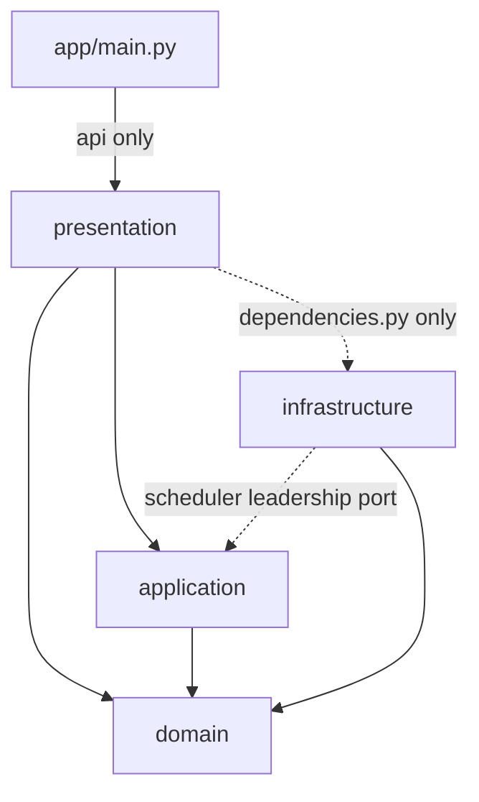

# Clean Architecture

`app/` has four layers, and dependencies point inward. The rules are
checked by `tests/architecture/test_layer_dependencies.py`, which is the
source of truth, and recorded in ADR 0082.

## Third-party packages

| Layer | May import besides the standard library |
|-------|-----------------------------------------|
| domain | nothing |
| application | nothing |
| infrastructure | psycopg, psycopg_pool |
| presentation | fastapi, pydantic, starlette |

`dependencies.py`, the composition root, may also import `psycopg_pool`.
No other presentation module may.

## Other rules

- A relative import may not leave its own package.
- `__import__` and `import_module` are not used.
- A module in `app/` must belong to a layer or be `app/main.py`.
